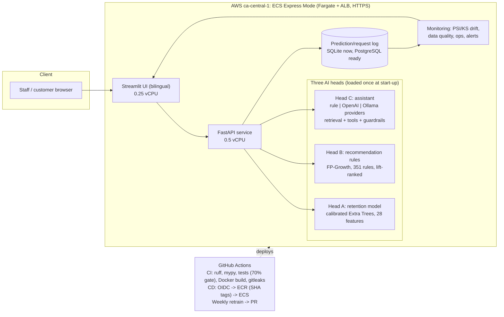

# Architecture and rationale

*Boréal Marché Customer Intelligence Platform · Manish Chauhan*

## Diagram

## Request flow
1. The UI (or any client) calls the API; every request gets an id, is timed and logged.
2. `POST /predict` scores a customer (Head A) and returns the probability, the decision (`target_with_offer` if < 0.82) and the model version; `POST /explain` returns the top factor groups for staff.
3. `POST /recommend` looks up association rules by basket (Head B) and falls back to popularity when no rule matches, and says so.
4. `POST /chat` and `/chat/stream` answer policy and product questions (Head C): retrieval over a policy corpus, tool calls (policy search, recommendations, product lookup), a pre-guard (privacy, out of scope) and a verifier that blocks product codes or percentages that no tool returned.
5. `GET /monitoring/summary` computes drift, data quality, operational metrics and the delayed-ground-truth status from the log.

## Key decisions and why
| Decision | Why | Trade-off |
|---|---|---|
| One joblib artifact (preprocessing + model + calibrator), loaded once at start-up | Serving cannot apply different preprocessing than training; a bad artifact fails the container before `/ready` is green | pickle executes code on load: only trusted artifacts; scikit-learn version pinned |
| Calibrated Extra Trees, threshold 0.82 | Probabilities are used for an expected-profit decision, so calibration matters; ET was best in the 9-family spot check | Isotonic calibration is a step function; scores for low-spend and new customers are capped near 0.52 (fairness finding) |
| Association rules (FP-Growth) instead of collaborative filtering | Basket-level, explainable, millisecond lookup, works without user histories | Low catalogue coverage (3.1%); popularity fallback when no rule fires |
| Provider interface for the assistant (rule, OpenAI, Ollama) | Hosted LLMs must not receive real personal data, so a local option is required; the default offline provider keeps CI deterministic | Real LLM quality and cost are not measured (no key in CI) |
| Human approval before any offer | Law 25 s.12.1: avoid a decision based exclusively on automated processing | Staff workload; the review must be meaningful (factors shown) |
| ECS Express Mode (Fargate + ALB) | App Runner is closed to new customers and Streamlit needs WebSockets | One task per service: no high availability, local SQLite state |
| GitHub OIDC for deployment | No long-lived AWS keys in the repository | Trust policy must match the exact repository subject (IDs) |
| Retraining opens a pull request, never deploys | A person reviews a model change; CI then deploys through the same pipeline | Slower than full automation; PRs made by the default token do not trigger CI unless a PAT is configured |
| Single-threaded forest at serve time (`n_jobs=1`) | Measured 3.2x faster single predictions, identical outputs | Concurrency comes from workers, not from the forest |

## Known limits
Single task per service; container-local log (wiped on redeploy); monitoring summary costs about 1 s of CPU per refresh at 5,000 rows;
no LLM key on the deployed service; policies are prototype placeholders. See `reports/` and the D5 report for measurements.

## Repository map
`app/` API and services · `ui/` Streamlit · `src/` data, features, training, rules, evaluation · `scripts/` retraining, simulation, audits,
profiling · `tests/` unit, contract, golden, data quality, assistant evaluation · `models/` shipped artifacts · `docs/` evidence and reports ·
`reports/` fairness, interpretability, performance outputs · `.github/workflows/` ci, deploy, retrain.
