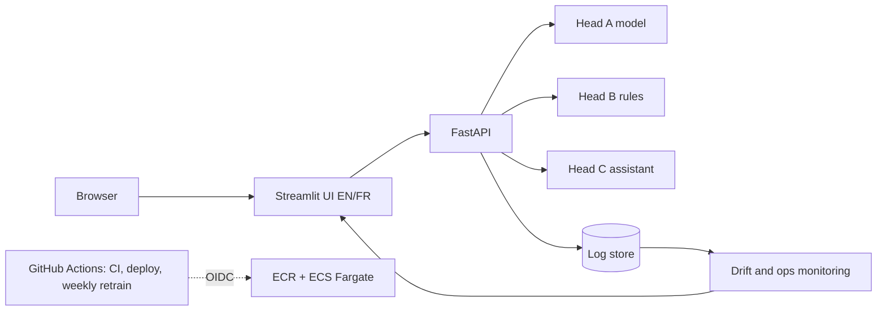

# Boréal Marché Customer Intelligence Platform

[](https://github.com/AI-DS-Git/boreal-marche-customer-intelligence/actions/workflows/ci.yml)
[](https://github.com/AI-DS-Git/boreal-marche-customer-intelligence/actions/workflows/deploy.yml)
[](https://github.com/AI-DS-Git/boreal-marche-customer-intelligence/actions/workflows/retrain.yml)

**One system that tells a retailer which customers are about to stop buying, what to recommend in a basket, and answers customer questions in English and French, deployed, monitored and governed under Quebec's Law 25.**

> **Demo video (60–90 s):** `ADD LINK HERE` &nbsp;·&nbsp; Full walkthrough (about 5 min): attached to the [v0.9 release](https://github.com/AI-DS-Git/boreal-marche-customer-intelligence/releases/tag/v0.9)

| | |
|---|---|
| **Live UI** (bilingual) | https://bo-18e314a8dc3544148369c0305041cb8f.ecs.ca-central-1.on.aws |
| **Live API docs** | https://bo-ef5fe6766e224e0c8c335d5b98addb0c.ecs.ca-central-1.on.aws/docs |
| **Check what is running** | `GET /version` returns the git SHA, model version and threshold |
| **Reports** | `reports/`: D5 optimization and ethics report, final technical report, bilingual executive summary, presentation deck, reflection; D3 validation report (repo root) |

*Status of the live links: hosted on AWS ECS Fargate; they stay up during grading and are deleted afterwards to stop billing.*

## What it does
| Head | Question it answers | Method | Endpoint |
|---|---|---|---|
| **A – Retention** | Will this customer order again in the next 90 days? | Calibrated Extra Trees on 28 purchase-behaviour features; a staff member reviews any offer when P(retain) < 0.82 | `POST /predict`, `POST /explain` |
| **B – Recommendations** | What goes with this basket? | FP-Growth association rules (351 rules), lift-ranked, popularity fallback | `POST /recommend` |
| **C – Assistant** | What is the return policy? Which product pairs with this? | Retrieval + tool calling + guardrails; rule, OpenAI or local Ollama provider | `POST /chat`, `/chat/stream` |

Around the heads: request logging, drift and ops monitoring with alerts, weekly retraining with a promotion gate, CI/CD with OIDC, and a Law 25 governance pack.

## Architecture

More detail and the reasoning behind each decision: [ARCHITECTURE.md](ARCHITECTURE.md).

## Results (with baselines)
**Head A – retention** (chronological split 70/15/15; held-out = 788 customers, looked at once for the reported numbers)

| Model | PR-AUC | ROC-AUC | Notes |
|---|---|---|---|
| No-skill baseline | 0.673 (CV) · 0.760 (held-out, = prevalence) | 0.500 | dummy classifier |
| Business rule: recency ≤ 45 days | 0.709 (CV) | 0.555 (CV) | one rule, no ML |
| Logistic regression | 0.799 (CV) | 0.671 (CV) | |
| **Extra Trees, tuned + calibrated (shipped)** | **0.875 (held-out)** · 0.819 (CV) | **0.730** (held-out) · 0.707 (CV) | |
| Random Forest (not shipped) | 0.879 (held-out) | 0.728 | slightly higher PR-AUC on held-out; Extra Trees won the cross-validated spot check and was chosen before the held-out look |

Decision rule: offer review if P(retain) < **0.82**, chosen on expected profit. Under the stated planning assumptions ($5 coupon, 20% margin, 30% recovery; not verified client financials), expected profit on the held-out slice is **$1,065.65 vs $201.36** for a blanket coupon.

**Head B – recommendations** (temporal hold-out, hit-rate@5): rule engine **0.404** vs popularity baseline 0.312 (1.30x); catalogue coverage 3.1% vs 0.3%.

**Head C – assistant** (40-question bilingual golden set, scored offline with the rule provider and in-sample): tool choice 97.5%, refusals 97.5%, citations 95%. *Not measured:* real LLM tool choice and real embedding quality (no API key or local model in CI); run `python scripts/eval_assistant.py --provider openai|ollama --save`.

**Engineering and operations** (details in the D5 report)

| Measure | Result |
|---|---|
| CI | ruff, mypy, tests with a 70% coverage gate, Docker build + smoke test, gitleaks; branch protection requires all four |
| Deploy | GitHub OIDC (no stored AWS keys) → ECR (SHA-tagged) → ECS; about 20 minutes; live `/version` checked against the commit |
| Prediction latency | 110 ms → 35 ms single prediction after serving the forest single-threaded (dev machine, identical outputs) |
| Monitoring | PSI/KS drift, data quality, error rate, p95 latency; green on normal traffic, red on a shifted cohort (frequency_orders PSI 0.63) |
| Cost | about $45 per month always-on (Fargate US-East rates, to confirm in Cost Explorer) |
| Fairness | recall 0% for spend quartiles Q1–Q3 and new customers (scores capped near 0.52); four mitigations tested, two did not help |

## Quickstart
Requirements: Docker, or Python 3.11. No raw dataset is needed to run the system (artifacts are committed).
```bash
git clone https://github.com/AI-DS-Git/boreal-marche-customer-intelligence.git
cd boreal-marche-customer-intelligence
cp .env.example .env            # all settings have safe defaults; no secrets are required
docker compose up --build       # API http://localhost:8000/docs   UI http://localhost:8501
```
Without Docker:
```bash
python -m venv .venv && source .venv/bin/activate     # Windows: .venv\Scripts\Activate.ps1
pip install -r requirements-dev.txt
python -m pytest -q                                   # unit, API contract, golden prediction, assistant evaluation
uvicorn app.main:app --port 8000 &                    # then: streamlit run ui/streamlit_app.py
```
Check it works: `curl localhost:8000/health` → `{"status":"ok"}`; open `/docs`; score the golden customer 12347 (expected retain probability 0.8095).
*Verification status:* the Docker build and smoke test run in CI on every pull request. A clean-machine run by another person is **pending** (see "What I would do next").

To reproduce the data and models (needs `data/raw/online_retail_II.xlsx` from the UCI repository): `make etl rules spotcheck train` (see `Makefile`).
Simulate traffic for the monitoring page: `python scripts/simulate_traffic.py --api http://localhost:8000 --n 600` (normal) and `--n 300 --drift` (shifted).

## Repository map
| Path | Contents |
|---|---|
| `app/`, `ui/` | FastAPI service and Streamlit front end |
| `src/` | data cleaning, features, training, calibration, rule mining, evaluation |
| `scripts/` | weekly retraining and promotion gate, traffic simulation, fairness/importance/latency audits, assistant evaluation |
| `tests/` | unit, API contract, golden prediction, data quality, monitoring, assistant evaluation |
| `models/` | shipped model, metadata sidecar and drift reference |
| `.github/workflows/` | `ci.yml`, `deploy.yml`, `retrain.yml` |
| `docs/`, `reports/` | evidence, figures, fairness, interpretability and performance outputs |
| [`MODEL_CARD.md`](MODEL_CARD.md), [`DATA_CARD.md`](DATA_CARD.md), [`GOVERNANCE_LOI25.md`](GOVERNANCE_LOI25.md), [`ARCHITECTURE.md`](ARCHITECTURE.md) | cards, Law 25 register and disclosure, architecture |

### Layout note: where the course's required paths live
The course specification lists a target layout; this repository grew with different names. Same contents, different places:

| Specified path | Here |
|---|---|
| `src/` | `src/` (training, features, rules) and `app/` (the serving API) |
| `docker/` | `Dockerfile`, `Dockerfile.ui`, `docker-compose.yml` at the repository root |
| `frontend/` | `ui/` (Streamlit) |
| `artifacts/` (model, metadata, rules, index) | `models/` (joblib model, metadata sidecar, drift reference); rules in `docs/head_b_rules.json` and `docs/head_b_popularity.json`; the retrieval index is built at start-up from `app/data/policies.json` |
| `docs/corpus/` | `app/data/policies.json` and `app/data/products.json` |
| `.github/workflows/` `ci.yml`, `cd.yml`, `retrain.yml` | `ci.yml`, `deploy.yml` (the delivery workflow), `retrain.yml` |
| `data/` (DVC-tracked) | `data/`; the raw dataset is never committed. DVC was planned in D2 and not adopted: the workbook's SHA-256 is recorded in the D2 report |
| `notebooks/` | not used: the work is in `src/` scripts, with the narrative in the reports |

## Honest limits
- **Data:** a public UK retailer dataset (UCI Online Retail II, 2009–2011), not real Boréal Marché data; one retailer, 91% UK.
- **Fairness:** low-spend, mid-spend and new customers are never scored above about 0.52, so all of them fall below the 0.82 cut-off. Every offer is reviewed by a person for this reason. Recalibration and reweighting did not fix it; the likely fix is better features.
- **Monitoring:** true accuracy cannot be measured until labels arrive 90 days later (first signal about 24 January 2027). The deployed log is container-local SQLite and resets on redeploy.
- **Assistant:** the deployed service runs the rule provider; no LLM key is configured. Policy texts are prototype placeholders.
- **Not run:** the SageMaker HPO comparison is written but was not executed (hyperparameters come from local tuning); no concurrent load test; no real-LLM assistant evaluation.
- **Cost assumptions** for the profit model ($5 / 20% / 30%) are planning assumptions, not client financials; varying all three together, the targeted policy loses to the blanket coupon in 5 of 27 scenarios (`scripts/profit_sensitivity.py`).

## What I would do next
1. Run the clean-machine test (a classmate follows this README) and fix whatever breaks.
2. Collect features that separate retained low-spend and new customers, then retrain without `country`.
3. Move the log to managed PostgreSQL, compute drift on a schedule, add per-segment offer rates to the dashboard.
4. Measure the assistant with a real LLM and a local model, and calibrate retrieval floors on those embedders.
5. Add scheduled log purging and erasure by request id; name a privacy officer and capture consent.

## AI tools and attribution
AI assistants (Claude) were used for scaffolding code, tests, documentation and analysis scripts. Everything was reviewed, run and
corrected by me; corrections and the one thing I got wrong are described in the final report. Third-party code is cited in comments.

*Dataset: UCI Online Retail II (public; licence stated in `DATA_CARD.md`). No real customer data is used.*
